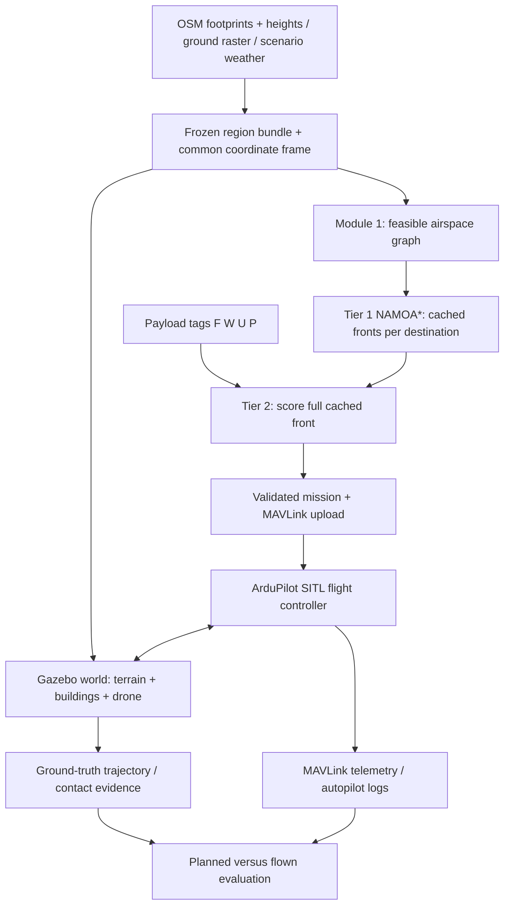

# Gazebo implementation plan — FYP B28

Date: 2026-10-06. Status: proposed; Gazebo/SITL execution not yet verified.

## 1. Target outcome

Load selected Chennai region into Gazebo with terrain elevation, building footprints and heights, collision geometry, depot and delivery pad. Existing Python planner builds Pareto fronts from same environment. Operator enters `(F, W, U, P)`; Tier 2 selects route; ArduPilot SITL flies corresponding mission. Record planned versus flown trajectory and clearance.

**Recommended stack:** Ubuntu 22.04 + Gazebo Harmonic + official `ArduPilot/ardupilot_gazebo` plugin + ArduCopter SITL + Python `pymavlink` + QGroundControl. Harmonic recommended by plugin maintainers. ROS unnecessary for initial integration; plugin communicates directly with SITL. [Official plugin](https://github.com/ArduPilot/ardupilot_gazebo), [ArduPilot setup](https://ardupilot.org/dev/docs/sitl-with-gazebo.html).

Current workspace macOS. Prefer team Ubuntu machine for initial validation. Native macOS possible per ArduPilot documentation; graphics/plugin build need separate smoke test. VM option depends on available GPU acceleration. Do not assume successful Gazebo GUI implies usable simulation performance.

Start with 1 km × 1 km region, one drone, one depot, one delivery point. Expand toward existing 6 km region after flight and performance gates pass. Suggested graph spacing initially 100–200 m; choose after obstacle-clearance validation. Terrain resolution and graph spacing remain separate settings.

## 2. Architecture and two-tier boundary



Gazebo supplies physics, sensors, environment. ArduPilot supplies flight control. Existing Python code supplies route planning. Mission waypoints connect planner to flight controller.

Preserve project contribution:

- Tier 1 stays payload-independent; build/cache once per destination and environmental refresh window.
- Tier 2 keeps existing algebraic weights and utility scoring across full feasible Pareto front.
- Payload-only change reruns Tier 2, not graph construction or NAMOA*.
- Geometry/feasibility changes invalidate graph/front before selection. Weather drift uses existing refresh policy.
- Initial graph remains 2.5D: latitude/longitude grid with one permitted altitude per node. Full multi-altitude 3D search optional later extension.

## 3. Existing code and required gaps

Inspection basis: checked-in implementation, not older context paragraphs describing missing terrain support.

| Component | Already available | Required work |
|---|---|---|
| `env_data.py` | Raster/API elevation providers; OSM layer cache; building-height fallback; geometry indexes | Frozen area bundle; provenance; strict real-data mode; common precise frame |
| `module1_graph_builder.py` | Lattice; terrain/building node altitudes; sampled risk; hard NFZ intersections | Hard terrain/building edge clearance; flight constraints; pad connectors |
| `module2_tier1_moastar.py` | NAMOA*, diagnostics, truncation flag | Reuse; benchmark feasible graph before increasing density |
| `pareto_store.py` | Static edge hash, weather drift/expiry | Include environment/frame/feasibility version and node coordinates/altitudes in identity |
| `module4_tier2_payload.py` | Formula, full-front score, `SelectionResult` with AMSL/AGL | Preserve formula; carry environment/mission identifiers |
| `mission_export.py` | QGC WPL export; collinear merge; RTL ending | Correct altitude reference; home data; takeoff/arrival; validated return; safe simplification |
| `dashboard.py` | Tag entry and export | Optional SITL upload/run/status controls after command-line path works |
| `SITL_NOTES.md` | Untested checklist | Replace incorrect frame-3/AGL description during exporter implementation |

**Blocking correctness gaps:**

1. Exporter currently writes `agl_m` into `MAV_FRAME_GLOBAL_RELATIVE_ALT` and into frame-0 home row. Frame 3 means altitude above home; frame 0 means MSL. Both need explicit altitude handling. [MAVLink frame definitions](https://mavlink.io/en/messages/common.html#MAV_FRAME).
2. Graph currently converts insufficient building/terrain clearance into risk, not general hard edge rejection. Terrain between endpoints interpolated from endpoint ground heights; intervening hill may disappear. Need collision feasibility before NAMOA*.
3. Collinear merge uses geographic-degree slopes and AGL. Terrain mission needs metric geometry, absolute altitude, and clearance recheck after merge.
4. Final RTL not guaranteed to follow chosen outbound route. Initial planned landing at delivery pad avoids unplanned urban return. Return mission requires separately validated corridor.

## 4. Region data: map, terrain, building heights

### Shared region bundle

Create immutable bundle under generated `Implementation/cache/regions/<region_id>/`:

```text
manifest.json              # bounds, origin, CRS, vertical datum, versions, checksums
terrain_source.tif         # clipped original raster
terrain_local.tif          # processed common ground surface
terrain_mesh.* / heightmap # Gazebo geometry derived from processed surface
buildings.gpkg             # normalized footprint + height + source/uncertainty
zones.gpkg                 # scenario restricted/water layers
pads.json                  # actual depot/arrival coordinates and ground elevations
```

Manifest records data dates, real/fixture mode, source resolution, missing-height counts, terrain processing method, height policy, safety margins, weather-scenario identity. Hash processed data and generation settings. Planner/world must reference identical bundle hash. Geometry bundle can be reused across separately versioned weather scenarios.

Reuse OSM acquisition from `env_data.py`; crop once with buffer around flight area. No network fetch during mission execution. Existing offline fixtures remain synthetic test data; real-map run must reject accidental fixture/flat-ground fallback.

### Terrain

Prefer surveyed/local bare-earth DTM when available. Otherwise use public elevation raster as approximate terrain, explicitly recording surface type and resolution. Export continuous surface, not sparse node elevations.

**Copernicus DEM is DSM:** includes vegetation and structures. Extruding OSM buildings on untreated DSM can double-count roof elevation. [Copernicus description](https://documentation.dataspace.copernicus.eu/Data/Others/CCM.html?q=COP-DEM_GLO-30-DGED).

For public DSM fallback: estimate ground beneath footprints from surrounding ground cells, document interpolation/uncertainty, inspect area manually. Treat result as approximate ground model; interpolation cannot recover measured ground. Use same corrected surface for graph, building foundations, Gazebo collision, trajectory-clearance evaluation. Retain original raster for reproducibility.

Crop, handle nodata, preserve physical metres, convert coordinate frame, and retain vertical datum metadata. Resampling 30 m source onto finer grid improves mesh sampling, not source accuracy. Flat/synthetic terrain useful for smoke tests; exclude from real-terrain evidence.

### Buildings

Initial height policy reuses current code:

1. Valid OSM `height` → total height above building base.
2. Else `building:levels × config.LEVEL_HEIGHT_M` (currently 3 m) → estimated height.
3. Else configured type default → assumed height.

Store `height_m`, `height_source`, original tags, footprint ID, base elevation and uncertainty policy. Counts of tagged/estimated/default heights required in results. OSM supports building outlines, parts, heights and levels; current data coverage for chosen crop must be measured. [OSM 3D specification](https://wiki.openstreetmap.org/wiki/Simple_3D_Buildings).

Later optional height upgrade: evaluate [GlobalBuildingAtlas](https://github.com/zhu-xlab/GlobalBuildingAtlas) tiles covering region. Product offers estimated heights/LoD1 geometry; coverage and errors require checks. Import through same normalization path, respect release-specific CRS/provenance, avoid duplicate buildings. Keep dataset attribution/license metadata with exported assets. Do not require this upgrade for first flight.

## 5. Coordinates and altitude contract

Implement shared `geo_frame.py`; preserve existing `LocalFrame.to_local/to_latlon` calling interface where practical. Use WGS84 local tangent ENU with explicit origin. Existing spherical equirectangular approximation must pass alignment test or be replaced across planner and environment indexes together.

Coordinate contract:

```text
Gazebo: x east, y north, z up; metres.
Planner geography: WGS84 latitude/longitude.
H_ground: ground elevation in declared common vertical datum.
H_flight = H_ground + desired_AGL.
H_origin: datum elevation corresponding to Gazebo z=0.
z_world = H_flight - H_origin.
H_home: actual launch/home altitude in same datum.
mission_relative_alt = H_flight - H_home.   # frame 3
```

Example: home ground 10 m MSL, remote ground 35 m MSL, required AGL 60 m. Flight altitude 95 m MSL; frame-3 altitude 85 m. Writing 60 m gives flight altitude 70 m MSL, only 35 m above remote ground.

Set Gazebo spherical coordinates to common geographic origin, ENU orientation, heading zero. [Gazebo coordinates](https://gazebosim.org/api/sim/8/spherical_coordinates.html).

Verify world-origin elevation convention against plugin/GPS output. Convert geoid/ellipsoid heights where required; DEM MSL, Gazebo reference elevation and GPS altitude must not be assumed interchangeable. Test known ground point and known hover height before terrain mission. For local MAVLink telemetry, convert NED `(north,east,down)` to ENU `(east,north,-down)` with correct EKF-origin translation.

Use frame 3 with computed relative-home heights for first implementation. Terrain frame 10 deferred until autopilot terrain provisioning uses compatible dataset and passes dedicated tests. Loading terrain into Gazebo does not automatically provision ArduPilot terrain-following database. [ArduPilot terrain following](https://ardupilot.org/copter/docs/terrain-following.html).

AGL ceiling checks remain against ground along flight path. Relative-home height above 120 m can still satisfy configured 120 m AGL ceiling over elevated terrain. Treat ceiling as project configuration in simulation.

## 6. Build Gazebo world

Create `gazebo_world_builder.py`. Outputs SDF world, terrain assets, building meshes, mapping from source IDs to simulation entities.

**Terrain:** first validate Harmonic heightmap collision support on pinned physics backend using [Gazebo heightmap example](https://github.com/gazebosim/gz-sim/blob/gz-sim8/examples/worlds/heightmap.sdf). Export supported heightmap format with explicit XY extent, physical height scale, vertical offset, row orientation. Check north/south orientation using known asymmetric hill. Static triangulated terrain mesh fallback if heightmap/backend integration fails; select one representation before experiments. Planner samples actual exported surface/interpolation so visual, collision and planning heights agree.

**Buildings:** repair polygons, handle multipolygons/holes, crop, convert to local metres, triangulate and extrude into LoD1 roof/wall volumes. Position foundations using processed ground surface. MVP uses conservative flat base/roof envelope over each footprint; store absolute roof elevation. Planner collision checks use same roof envelope, including on slopes. Add both `<visual>` and `<collision>` geometry to static models. Preserve footprint shape in collision representation; bounding boxes may unnecessarily block corridors. Building parts must not create duplicate overlapping outline volumes.

**World:** start from official Iris world systems/model; preserve plugin, sensor, gravity and vehicle settings. Add geographic reference, terrain, buildings, launch/arrival pads, axis markers. Cache vehicle/resources locally. Road/water textures and NFZ overlays optional visual aids; restricted zones enforced by planner/mission checks, not physical walls.

**Performance:** start with simple materials, no camera streaming, reduced decorative detail. Include all collision geometry intersecting validated flight corridor plus margin. Measure real-time factor before extending region. Splitting meshes into tiles optional if full region too slow.

**Collision verification:** drop test object onto slope and roof; verify contact, pose and source elevations. Flight evaluation combines Gazebo ground-truth pose with geometry-clearance analysis; add contact evidence where supported by chosen backend. No-contact message alone proves nothing unless contact reporting verified.

## 7. Make graph routes flyable

Extend Module 1 before Tier 1 runs:

- Sample actual common terrain along edge; never interpolate only endpoint terrain.
- Intersect buffered horizontal segment with building footprints; evaluate roof clearance over intersecting portions. Fixed 25 m point samples can miss narrow building. Use polygon intersection plus adaptive terrain checks.
- Buffer for drone dimensions, horizontal tracking error, geometry uncertainty. Vertical clearance includes configured 15 m plus declared uncertainty/control allowance.
- Reject edges violating clearance, configured AGL ceiling, restricted zones, climb/descent limits or map bounds.
- Verify complete flight corridor, including diagonal links. No safe endpoint assumption.
- If edge requires higher altitude, change graph geometry and costs before front generation, or remove edge. Never raise selected waypoints afterward while retaining old objective values.
- Attach actual launch/arrival points to graph with checked connectors. Vertical takeoff/climb, cruise-to-pad approach and descent need clearance too; snapping delivery coordinate alone insufficient.
- Handle empty/disconnected graphs and unreachable pads explicitly. Return no feasible mission.

Initial flight uses conservative speed and brief waypoint holds to limit corner cutting. Autopilot trajectory can deviate from straight graph edges; evaluate swept corridor at corners and altitude transitions. Tight-turn/spline smoothing only after clearance checks and objective recomputation where geometry changes. Keep original waypoints initially; disable current collinear merge.

Graph/frontend cache identity includes bundle hash, node geography/altitudes, frame, feasibility settings and graph-generation version. Existing static edge-only hash cannot fully represent world identity. Reject mismatched/truncated fronts for final validation runs; exploratory capped runs labelled approximate.

## 8. Mission execution and logs

Create `sitl_mission_runner.py`, `simulation_logger.py`, `evaluate_gazebo_run.py`.

Mission sequence: valid launch/home → `NAV_TAKEOFF` → source cruise point → selected path waypoints → arrival hold/approach → `NAV_LAND` on checked delivery pad. Payload release optional later. If round trip needed, plan/cache directed return route and check round-trip battery estimate. Wind makes reverse path costs differ. Do not append unvalidated straight RTL as nominal return.

Runner responsibilities:

1. Check bundle/front/mission identity, complete front, weather gate, clearance and data mode.
2. Connect MAVLink, wait heartbeat/EKF readiness, read actual home, verify expected pad and altitude.
3. Convert mission heights; distinguish mission-file home row from uploaded flight commands. Reject missing geography/altitudes instead of default 60 m in real-map mode.
4. Upload using MAVLink mission protocol; handle requests/retries and require accepted `MISSION_ACK`. Optionally download and compare commands/coordinates before flight. [Mission protocol](https://mavlink.io/en/services/mission.html).
5. Arm, run AUTO, monitor mission progression, disarm/landing, timeout and failsafe events. Preselect checked simulation abort/landing behavior; log departure from planned corridor.
6. Save run manifest, selected route, mission items, MAVLink telemetry, autopilot log and Gazebo pose evidence. Record both simulation and wall-clock timestamps.

Launch smoke test after stack installation (documented commands; not run here):

```bash
# Terminal 1: official plugin example, resource paths already configured
gz sim -v4 -r iris_runway.sdf

# Terminal 2: ArduPilot tools available on PATH
sim_vehicle.py -v ArduCopter -f gazebo-iris --model JSON --map --console
```

Custom region launcher generates matching world reference, spawn pose and SITL location/home settings from manifest. Exact custom command locked after geographic-alignment smoke test. GUI takeoff plus three-waypoint flat-world mission must pass before real map.

## 9. Weather, payload physics and claims

First flight calm/static. Later freeze same weather snapshot for planner and simulator, then test headwind/crosswind cases. Meteorological direction means wind **from**; Gazebo ENU vector points **toward**:

```text
v = speed_kmh / 3.6
wind_east  = -v * sin(direction_from_deg)
wind_north = -v * cos(direction_from_deg)
```

Use one verified physical wind path. Confirm selected drone model receives force; setting world wind alone insufficient. Check built-in [WindEffects](https://gazebosim.org/api/sim/8/classgz_1_1sim_1_1systems_1_1WindEffects.html), vehicle drag and SITL settings to prevent double application. Urban meshes do not automatically generate building wakes/CFD turbulence. Spatial turbulence needs explicit later model.

Separate experiments:

- **Selection proof:** same graph/front/physics, vary tags, report chosen Pareto points and flight paths; repeated picks acceptable if actual front makes them optimal.
- **Payload physics:** declare kg mapping separately from ordinal weight class; update Gazebo vehicle mass/inertia/attached payload and controller setup consistently between runs. Check flight envelope. Tier 1 energy remains proxy under current reusable-front model; do not claim per-mass physical optimality without validated model.

Gazebo battery telemetry not assumed calibrated. Report planner energy proxy separately. Physical energy in Wh only if verified voltage/current or propulsion power model exists: `E_Wh = integral(V * I dt) / 3600`. Risk score remains modeled exposure, not measured crash probability. Record actual clearance/violations as simulation outcomes.

## 10. Implementation phases and acceptance gates

Estimated effort: 3–4 weeks for one-region MVP, assuming working Linux graphics and accessible data. Estimates exclude calibrated energy, CFD and hardware.

| Phase | Effort | Deliverable | Acceptance gate |
|---|---|---|---|
| 0. Stack smoke test | 1–2 days | Pinned setup notes + official Iris flight | Stable hover; flat AUTO mission; logs; near-real-time simulation |
| 1. Shared data/frame | 2–3 days | Region bundle, frame helpers, coverage report | Offline reproducible build; verified coordinates/datum; missing-data rejection |
| 2. World generation | 3–4 days | Terrain + extruded buildings + collision world | Ground/roof alignment; object-drop contact tests; height provenance |
| 3. Feasible routes/export | 3–4 days | Hard edge checks, pad connectors, fixed altitude export | Hill/narrow-building regression cases; validated complete mission; refreshed fronts |
| 4. SITL integration | 2–3 days | Python uploader/logger; one selected route flown | Accepted mission; successful pad arrival/landing; trajectory + clearance evidence |
| 5. Experiment suite | 3–5 days | Four presets, baselines, wind cases, figures/video | Same cached front reused; measured outcomes; comparable repeated runs |

Critical dependency: phase 1 → phases 2/3 → phase 4 → phase 5. Do not evaluate algorithm with world built from different data than graph.

Proposed new files, following existing flat-script structure:

```text
Implementation/geo_frame.py
Implementation/prepare_sim_region.py
Implementation/gazebo_world_builder.py
Implementation/route_clearance.py
Implementation/sitl_mission_runner.py
Implementation/simulation_logger.py
Implementation/evaluate_gazebo_run.py
Implementation/requirements-simulation.txt
Implementation/gazebo/README.md
Implementation/gazebo/templates/region.sdf.template
Implementation/gazebo/launch_region.sh
Implementation/tests/test_geo_frame.py
Implementation/tests/test_route_clearance.py
Implementation/tests/test_simulation_mission.py
```

Dependencies: retain existing geospatial stack; add explicit `rasterio`, `pyproj`, `trimesh` plus tested polygon triangulator, `pymavlink` in separate simulation requirements. Put tunables in `config.py`. Pin tested Gazebo/plugin/ArduPilot versions or commits in setup manifest. Generated worlds/meshes and telemetry stay under cache/output directories; ignore large generated artifacts in Git. Commit reusable scripts, templates, small fixtures and plans.

## 11. Validation and review evidence

Suggested initial acceptance targets; revise from measured controller performance/data uncertainty, then freeze before comparisons:

| Check | Proposed target |
|---|---|
| Coordinate round trip | Numerical local error < 0.1 m on test points |
| World/planner XY alignment | < 0.5 m at surveyed simulation control points |
| Exported surface agreement | < 0.5 m between planner and Gazebo representation; excludes source-data uncertainty |
| Flat-world flight tracking | Cross-track RMSE ≤ 3 m; max ≤ 5 m at initial conservative speed |
| Terrain/roof clearance | At least configured margin throughout flown path, including launch/arrival |
| Flight completion | All calm MVP repetitions arrive and land; zero geometry/NFZ violations |
| Tier 2 reuse | Same front hash and no new NAMOA* run across tag-only changes |
| Selection latency | ≤ 1 s wall-clock from cached-front tag entry to selected result; upload measured separately |
| Runtime performance | Sustained real-time factor ≥ 0.8 on selected machine, or document headless/size reduction |

Offline regression fixtures: uphill route exposing AGL/home bug; ridge between safe endpoints; thin roof missed by 25 m sampling; blocked diagonal; unsafe shortcut after merge; mismatched world/front; unsafe return; no feasible route; weather HOLD; mission upload rejection/timeout.

Run existing `python -m unittest discover -s Implementation/tests` after code changes. Add focused correctness tests above, then Gazebo integration tests. Versioned test suite distinguishes numerical agreement with synthetic geometry from accuracy of real map.

Experiment matrix: flat/no-building smoke world; controlled hill+tall-building fixture; frozen real-data urban crop; calm and specified wind cases. Fly selected routes for four project presets and single-objective baselines. Suggested 5 repetitions per condition for integration variability; enlarge if uncertainty warrants. Reset home/weather/state between runs. Hold physical mass constant for tag-only selection comparison.

Deliver tables/plots: selected objective vector/ranks, front identity, Tier 1 build/cache time, Tier 2 latency, upload latency, flight completion/time/distance, cross-track error, minimum ground/roof clearance, ceiling/NFZ violations, failsafe/contact evidence, energy proxy and separately validated power data if available. Evaluate cruise segment and full mission separately so takeoff/landing cost not mistaken for planned route cost.

Final review package: reproducible offline region bundle, data coverage report, generated world, four preset selections, planned/flown 3D overlay, metric CSV, run manifests and flight video. Label tagged versus assumed heights and proxy versus physical metrics. Successful collision-aware flight validates route execution in chosen simulation model; source data and aircraft realism remain separate questions.

## 12. First implementation slice

Begin phase 0 plus altitude/frame regression design. Then freeze small region bundle and generate terrain/building world. Preserve current Tier 2 formula throughout. Expand region, physical wind and payload modeling only after first terrain-aware route completes successfully.
